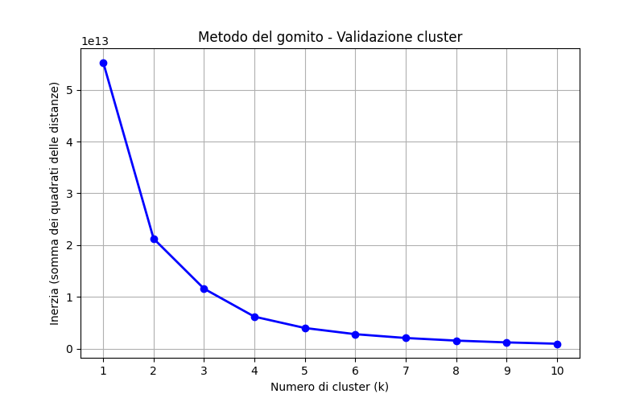

Progetto Avanzato di Business Intelligence per l'Ottimizzazione dell'Inventario

Questo repository contiene un progetto end-to-end volto ad analizzare, bonificare e segmentare l'inventario di un grande database commerciale per identificare i codici prodotto inefficienti e ottimizzare il capitale aziendale immobilizzato.

 Sintesi dell'Impatto di Business
Grazie all'applicazione di un algoritmo di Machine Learning e ad un'accurata bonifica dell'anagrafica articoli, il progetto ha permesso di:
- Analizzare un magazzino con un valore economico totale pulito di 192 Milioni di unità monetarie e 20,19 Milioni di sconti applicati.
- Identificare ed eliminare anomalie strutturali (outliers) e record ridondanti, ottimizzando il database da 3.732 righe iniziali a 1.681 righe di prodotti unici.
- Isolare una "Lista Nera" di soli 15 codici critici (Cluster 2) che da soli occupavano 12 Milioni di liquidità aziendale, offrendo un obiettivo di risparmio immediato e mirato.

 Architettura del Progetto e Fasi di Lavoro
Fase 1: Esplorazione dei Dati
Strumenti utilizzati: Python, libreria Pandas.
Attività: Analisi della dimensionalità del database industriale, controllo della consistenza dei tipi di dato e verifica dei valori mancanti. Gestione dei problemi di decodifica dei caratteri speciali.

Fase 2: Feature Engineering (Bonifica dei Dati)
Strumenti utilizzati: Python, libreria Pandas.
Attività: Creazione di indicatori finanziari avanzati come il Capitale Immobilizzato ('Stock_Value') e lo Sconto Reale ('Discount_Value'). 
Consolidamento Anagrafica: Sviluppo di uno script di aggregazione logica per fondere i prodotti duplicati che presentavano lo stesso nome testuale ma indici diversi, sommando correttamente le giacenze fisiche e garantendo la quadratura del capitale al centesimo.

Fase 3: Intelligenza Artificiale & Machine Learning (Clustering)
Strumenti utilizzati: Python, libreria Scikit-Learn.
Algoritmo:K-Means Clustering.
Validazione Scientifica: Implementazione del Metodo del Gomito (Elbow Method) per analizzare l'inerzia matematica (errore) del modello e convalidare oggettivamente la scelta ottimale di 3 Cluster.
Segmentazione (divisione dei prodotti in 3 archetipi commerciali distinti):
- Cluster 0 (81 MLN di prodotti): Prodotti sani ad alta rotazione e prezzo pieno.
- Cluster 1 (99 MLN di prodotti): Articoli stabili ma ad alto rischio di overstock.
- Cluster 2 (12 MLN di prodotti): Codici dormienti/obsoleti ad alto valore accumulato ed in forte svendita.

Fase 4: Business Intelligence & Visualizzazione Interattiva
Strumenti utilizzati:Power BI Desktop, formule DAX.
Attività:- Creazione di una dashboard manageriale dinamica. Pulizia finale degli outlier estremi in Power Query.
         - Sviluppo di misure DAX, attraverso cui la dashboard calcola l'incidenza percentuale di ciascun cluster e il tasso di svalutazione della merce.
Questa impostazione interattiva rappresenta uno strumento decisionale immediato: basta un clic sul grafico per isolare i 15 codici critici e quantificare all'istante il risparmio economico potenziale, consentendo all'ufficio acquisti di bloccare i riordini inefficienti o pianificare liquidazioni mirate senza perdere tempo in controlli manuali.

 Struttura dei File nel Repository
- esplora_dati.py: Script Python per la radiografia iniziale del database.
- prepara_dati.py: Codice per il calcolo delle metriche finanziarie iniziali ('Stock_Value' e 'Discount_Value').
- bonifica_dati.py: Codice per il consolidamento delle anagrafiche e la fusione dei duplicati.
- applica_machine_learning.py: Script di addestramento dell'algoritmo K-Means.
- validazione_gomito.py: Simulazione matematica per la convalida del numero di cluster.
- ispezione_obsoleti.py: Script per filtrare, isolare e analizzare l'impatto economico della lista nera.
- ottimizzazione_inventario.pbix: Il file finale della dashboard interattiva di Power BI.