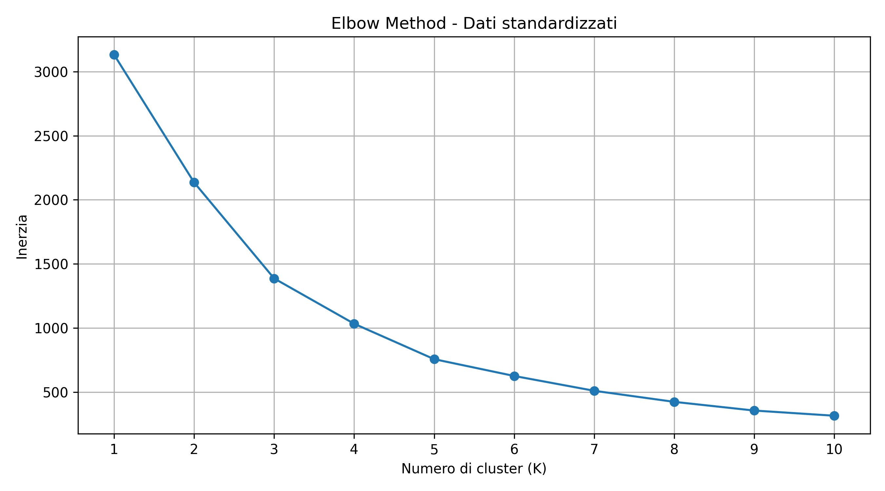
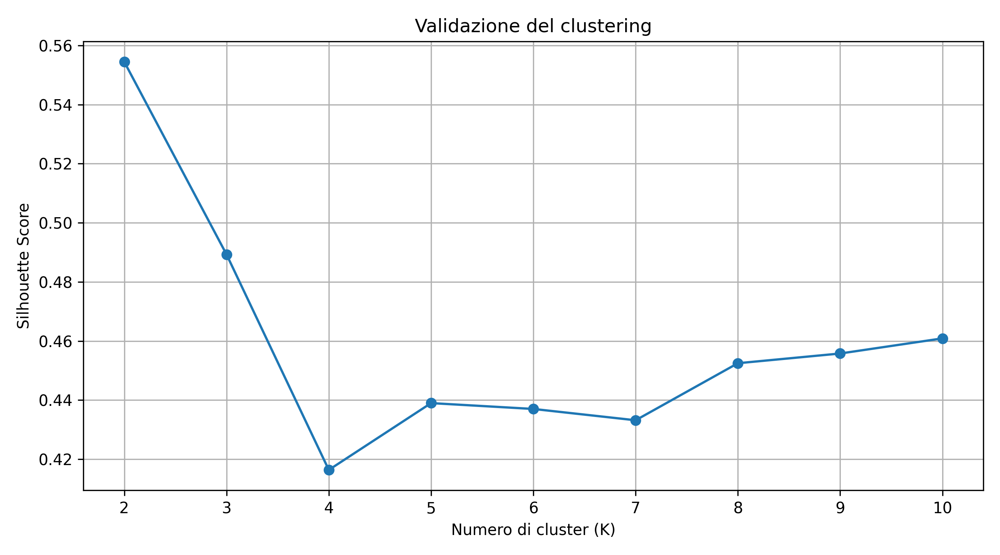
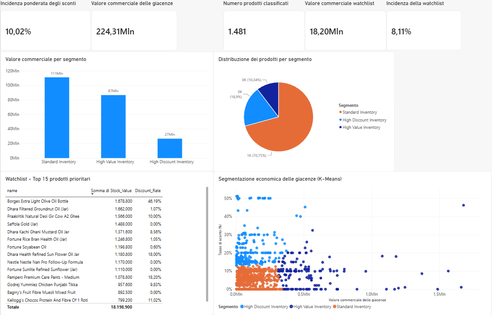

Inventory Analytics & Master Data Quality

Analisi delle giacenze, Data Cleansing, Machine Learning e Business Intelligence

1. Project Overview
Il progetto sviluppa un processo analitico end-to-end finalizzato all'analisi, al consolidamento e alla segmentazione economica delle giacenze di un dataset commerciale.
Attraverso l'integrazione di tecniche di Data Quality, Feature Engineering, Machine Learning e Business Intelligence, il progetto si propone di:
- Migliorare la consistenza dell'anagrafica prodotti.
- Consolidare i record attraverso una chiave identificativa composta.
- Costruire indicatori economici a supporto dell'Inventory Management.
- Segmentare i prodotti mediante un algoritmo di apprendimento non supervisionato.
- Identificare i prodotti economicamente prioritari da sottoporre a ulteriori verifiche.
- Sviluppare una dashboard interattiva a supporto delle decisioni gestionali.

2. Executive Summary
Principali risultati
- 3.732 record iniziali.
- 1.782 record consolidati.
- 1.950 righe accorpate.
- 52,25% di riduzione del numero di record.
- 215 prodotti senza giacenza.
- 1 anomalia economica identificata ed esclusa dal clustering.
- 1.566 prodotti classificati mediante K-Means.
- 224,31 milioni di valore commerciale complessivo delle giacenze.
- 10,02% di incidenza ponderata degli sconti.
- 15 prodotti economicamente prioritari.
- 18,20 milioni di valore commerciale della watchlist, pari all'**8,11%** del valore complessivo delle giacenze.

I valori monetari sono espressi nelle unità originali del dataset.

3. Dataset
Il progetto utilizza il dataset commerciale `zepto_v2.csv`, contenente informazioni relative alle anagrafiche prodotto, alle categorie merceologiche, ai prezzi di vendita, agli sconti e alle quantità disponibili.
Le principali variabili utilizzate sono:
- 'name': denominazione del prodotto.
- 'Category': categoria merceologica.
- 'mrp': prezzo massimo di vendita al dettaglio.
- 'discountedSellingPrice': prezzo di vendita scontato.
- 'availableQuantity': quantità disponibile.
- 'weightInGms': peso del prodotto in grammi.
- 'discountPercent': percentuale di sconto presente nel dataset.
- 'outOfStock': indicatore di indisponibilità.

4. Architettura del progetto e fasi di lavoro

Fase 1 – Exploratory Data Analysis

Strumenti utilizzati: Python, Pandas.

L'esplorazione iniziale del dataset comprende:
- Analisi della dimensionalità del database.
- Verifica della struttura e dei tipi di dato.
- Controllo dei valori mancanti.
- Analisi delle ripetizioni nelle denominazioni dei prodotti.
- Gestione della codifica dei caratteri speciali.
- Analisi preliminare della consistenza delle anagrafiche.

Questa fase costituisce la base per la successiva preparazione e bonifica dei dati.

Fase 2 – Feature Engineering

Strumenti utilizzati: Python, Pandas.

Sono stati costruiti quattro indicatori economici derivati dalle informazioni presenti nel dataset.

Stock_Value (Valore commerciale delle giacenze)

Stock_Value = availableQuantity × discountedSellingPrice

Rappresenta il valore commerciale delle quantità disponibili, calcolato al prezzo di vendita scontato.

Unit_Discount (Sconto unitario)

Unit_Discount = mrp − discountedSellingPrice

Rappresenta la differenza tra il prezzo massimo di vendita e il prezzo effettivamente proposto.

Total_Stock_Discount (Sconto complessivo sulle giacenze)

Total_Stock_Discount = Unit_Discount × availableQuantity

Quantifica la differenza complessiva tra il valore delle giacenze a prezzo pieno e quello a prezzo scontato.

Discount_Rate (Tasso di sconto ponderato)

Discount_Rate = Total_Stock_Discount / (Stock_Value + Total_Stock_Discount)

L'indicatore viene ricalcolato dopo il consolidamento delle anagrafiche, ponderando gli sconti rispetto al valore delle giacenze a prezzo pieno.

 Fase 3 – Master Data Quality & Data Cleansing

Strumenti utilizzati: Python, Pandas.

È stato implementato un processo di normalizzazione e consolidamento delle anagrafiche prodotto.

La normalizzazione testuale comprende:

- Conversione delle denominazioni in caratteri minuscoli.
- Rimozione degli spazi iniziali e finali.
- Normalizzazione degli spazi multipli.

In assenza di un identificativo SKU univoco, è stata definita una chiave composta basata su:

- Denominazione normalizzata del prodotto ('name_normalized').
- Peso del prodotto ('weightInGms').

Questa scelta consente di distinguere prodotti con la stessa denominazione ma differenti formati o grammature.

Il consolidamento ha permesso di passare da 3.732 record iniziali a 1.782 record aggregati, con una riduzione del numero di righe pari al 52,25%.

È stata inoltre verificata la conservazione del valore commerciale complessivo delle giacenze:

- Valore prima del consolidamento: 224.308.060.
- Valore dopo il consolidamento: 224.308.060.
- Differenza: 0.

La quadratura costituisce un controllo di coerenza aritmetica del processo di aggregazione.

Fase 4 – Data Quality e preparazione al Machine Learning

Prima dell'applicazione dell'algoritmo di clustering sono stati effettuati ulteriori controlli di ammissibilità dei record.

Dei 1.782 record consolidati:

- 215 risultano privi di giacenza.
- 1.567 presentano giacenza positiva.
- 1 presenta un'anomalia economica.
- 1.566 risultano ammissibili al clustering.

I prodotti senza giacenza sono stati esclusi dall'analisi di segmentazione economica.

È stata inoltre identificata un'anomalia relativa a un prodotto con giacenza positiva ma valore economico nullo, per il quale non risultava definibile il tasso di sconto.

Il record anomalo è stato escluso dal clustering e conservato separatamente per consentire eventuali verifiche successive, evitando imputazioni arbitrarie.

Fase 5 – Machine Learning: K-Means Clustering

Strumenti utilizzati: Python, Scikit-learn.

È stato implementato l'algoritmo K-Means, una tecnica di apprendimento non supervisionato finalizzata all'identificazione di gruppi di osservazioni con caratteristiche simili.

Le variabili selezionate per il clustering sono:

- 'Stock_Value': valore commerciale delle giacenze.
- 'Discount_Rate': tasso di sconto ponderato.

Standardizzazione delle variabili

Prima dell'addestramento è stato applicato StandardScaler, in modo da rendere confrontabili le due variabili, caratterizzate da scale numeriche differenti.

La standardizzazione evita che la variabile monetaria domini il calcolo delle distanze esclusivamente per effetto del suo ordine di grandezza.

Configurazione del modello

- Algoritmo: K-Means.
- Numero di cluster: 3.
- Random state: 42.
- Numero di inizializzazioni: 10.
- Osservazioni analizzate: 1.566.

Fase 6 – Validazione del modello

La valutazione del numero di cluster è stata effettuata attraverso due strumenti complementari:

- Elbow Method: analisi dell'andamento dell'inerzia al variare del numero di cluster.
- Silhouette Score: valutazione della coesione interna e della separazione tra i cluster.

Sono state analizzate configurazioni comprese tra K=1 e K=10, calcolando il Silhouette Score per K maggiore o uguale a 2.

I principali risultati sono:

- K=2: inerzia pari a 2.135,55 e Silhouette Score pari a 0,5545.
- K=3: inerzia pari a 1.386,78 e Silhouette Score pari a 0,4893.
- K=4: inerzia pari a 1.033,14 e Silhouette Score pari a 0,4164.

La configurazione a tre cluster è stata selezionata come compromesso tra qualità statistica e interpretabilità economico-gestionale.
Sebbene il Silhouette Score raggiunga il massimo per K=2 tra le configurazioni analizzate, la soluzione K=3 mantiene un punteggio pari a 0,4893 e consente di distinguere tre segmenti commerciali funzionali a differenti strategie di monitoraggio delle giacenze.

Elbow Method

Silhouette Score

Fase 7 – Cluster Analysis

L'applicazione dell'algoritmo ha consentito di identificare tre segmenti economici distinti.

Cluster 0 – High Value Inventory
- Numero di prodotti: 162.
- Incidenza numerica: 10,34%.
- Valore commerciale complessivo: 86,60 milioni.
- Valore commerciale medio: 534.595,68.
- Tasso di sconto medio: 8,69%.

Prodotti caratterizzati da un valore commerciale delle giacenze significativamente superiore rispetto agli altri segmenti.
Rappresentano una priorità per il monitoraggio economico dell'inventario e per eventuali approfondimenti relativi alle politiche di approvvigionamento.

Cluster 1 – Standard Inventory
- Numero di prodotti: 1.108.
- Incidenza numerica: 70,75%.
- Valore commerciale complessivo: 111,02 milioni.
- Valore commerciale medio: 100.196,53.
- Tasso di sconto medio: 4,67%.

Segmento maggiormente rappresentato, caratterizzato da valori commerciali medi relativamente contenuti e da un basso tasso di sconto medio.
Costituisce il principale gruppo di riferimento per il monitoraggio ordinario delle giacenze.

Cluster 2 – High Discount Inventory
- Numero di prodotti: 296.
- Incidenza numerica: 18,90%.
- Valore commerciale complessivo: 26,69 milioni.
- Valore commerciale medio: 90.154,73.
- Tasso di sconto medio: 21,60%.

Prodotti caratterizzati da un tasso di sconto medio significativamente superiore rispetto agli altri segmenti.
Rappresentano un gruppo di interesse per approfondimenti sulle politiche commerciali e promozionali.

I tassi di sconto medi riportati rappresentano la media aritmetica dei tassi di sconto dei prodotti appartenenti a ciascun cluster.

Fase 8 – Priority Watchlist

È stato sviluppato uno script dedicato all'identificazione dei prodotti economicamente prioritari.
Il processo comprende:
1. Identificazione dinamica del cluster con il maggiore valore commerciale medio delle giacenze.
2. Selezione dei prodotti appartenenti al cluster prioritario.
3. Ordinamento decrescente per Stock_Value.
4. Estrazione dei primi 15 prodotti.
5. Calcolo del valore commerciale complessivo e della relativa incidenza sull'inventario.

Risultati dell'analisi:
- Cluster prioritario: High Value Inventory.
- Prodotti appartenenti al cluster: 162.
- Prodotti selezionati: 15.
- Incidenza numerica sui prodotti classificati: 0,96%.
- Valore commerciale della watchlist: 18.198.900.
- Incidenza sul valore complessivo: 8,11%.

Meno dell'1% dei prodotti classificati concentra oltre l'8% del valore commerciale complessivo delle giacenze.
La watchlist costituisce uno strumento di prioritizzazione delle attività di controllo, consentendo di concentrare gli approfondimenti su un insieme circoscritto di prodotti economicamente rilevanti.
I risultati sono esportati nel file 'top_15_prodotti_da_verificare.csv'.

Fase 9 – Business Intelligence & Data Visualization

Strumenti utilizzati: Microsoft Power BI Desktop, Power Query, DAX.
È stata sviluppata una dashboard interattiva per rappresentare i risultati dell'analisi e supportare il monitoraggio gestionale delle giacenze.
La dashboard comprende nove visualizzazioni.

Key Performance Indicators
- Valore commerciale complessivo delle giacenze.
- Numero di prodotti classificati.
- Incidenza ponderata degli sconti.
- Valore commerciale della watchlist.
- Incidenza della watchlist sul valore complessivo.

Visualizzazioni analitiche
- Grafico a colonne del valore commerciale per segmento.
- Grafico a torta della distribuzione dei prodotti per segmento.
- Grafico a dispersione della segmentazione K-Means.
- Tabella dei 15 prodotti prioritari.

Sono state sviluppate misure DAX per il calcolo degli indicatori aggregati e delle incidenze percentuali.
Il grafico a dispersione consente di visualizzare la distribuzione dei prodotti rispetto alle due variabili utilizzate dal modello, distinguendo i segmenti attraverso differenti colori.

5. Applicazioni di business 

Il progetto propone un framework analitico applicabile a differenti attività aziendali:
- Inventory Management.
- Supply Chain Analytics.
- Master Data Management.
- Data Quality Management.
- Monitoraggio delle giacenze.
- Analisi delle politiche commerciali.
- Prioritizzazione delle attività di controllo.
- Decision Support Systems.

L'integrazione tra Python e Power BI consente di trasformare dati commerciali grezzi in indicatori sintetici e visualizzazioni utilizzabili a supporto delle decisioni.

6. Assunzioni e limitazioni

L'interpretazione dei risultati richiede alcune precisazioni metodologiche:
- Il dataset non contiene un identificativo SKU univoco. La chiave composta da denominazione normalizzata e peso rappresenta pertanto un'approssimazione dell'identità del prodotto.
- Il consolidamento assume che le quantità dei record aggregati siano additive. Tale ipotesi richiederebbe una verifica attraverso il sistema informativo di origine.
- La riduzione del numero di record non equivale necessariamente all'eliminazione di duplicati effettivi.
- La conservazione del valore commerciale complessivo verifica la coerenza aritmetica dell'aggregazione, ma non garantisce da sola la correttezza semantica delle anagrafiche.
- Stock_Value rappresenta il valore commerciale delle giacenze e non il capitale immobilizzato calcolato al costo di acquisto.
- Gli sconti commerciali non costituiscono necessariamente perdite economiche o svalutazioni contabili.
- L'assenza di dati storici relativi a vendite, movimentazioni, anzianità delle scorte e domanda non consente di determinare direttamente rotazione, obsolescenza o sovrastoccaggio.
- La watchlist identifica priorità di approfondimento e non risparmi economici effettivamente conseguibili.
- La scelta di tre cluster privilegia l'interpretabilità gestionale rispetto alla massimizzazione del Silhouette Score.
- I valori monetari sono mantenuti nelle unità originali del dataset.

7. Tecnologie e competenze

Tecnologie utilizzate
- Python: sviluppo della pipeline analitica.
- Pandas: Data Manipulation, Data Cleansing e aggregazione.
- NumPy: elaborazione numerica.
- Scikit-learn: standardizzazione, K-Means e validazione.
- Matplotlib: visualizzazione delle metriche di validazione.
- Power Query: importazione e tipizzazione dei dati.
- DAX: calcolo degli indicatori gestionali.
- Power BI: dashboard e Data Visualization.
- GitHub: documentazione e condivisione del progetto.

 Competenze applicate
- Exploratory Data Analysis.
- Master Data Quality.
- Data Cleansing.
- Feature Engineering.
- Data Validation.
- Unsupervised Machine Learning.
- Inventory Analytics.
- KPI Development.
- Business Intelligence.

8. Struttura del repository 

Script Python
- 'esplora_dati.py': esplorazione preliminare del dataset.
- 'prepara_dati.py': costruzione degli indicatori economici.
- 'bonifica_dati.py': normalizzazione e consolidamento delle anagrafiche.
- 'applica_machine_learning.py': controlli di ammissibilità, standardizzazione e clustering.
- 'validazione_gomito.py': metodo del gomito e Silhouette Score.
- 'analisi_prodotti_critici.py': identificazione dei prodotti prioritari.

Dataset e risultati
- 'zepto_v2.csv': dataset originale.
- 'zepto_preparato.csv': dataset arricchito con gli indicatori economici.
- 'zepto_bonificato.csv': dataset consolidato.
- 'zepto_con_cluster.csv': dataset classificato mediante K-Means.
- 'anomalie_clustering.csv': record anomali esclusi dal modello.
- 'top_15_prodotti_da_verificare.csv': watchlist dei prodotti prioritari.

Grafici e report
- 'grafico_metodo_gomito.png': visualizzazione dell'inerzia.
- 'grafico_silhouette.png': visualizzazione del Silhouette Score.
- 'dashboard_powerbi.png': anteprima della dashboard.
- 'ottimizzazione_inventario.pbix': report interattivo Power BI.

 9. Esecuzione del progetto

Per riprodurre l'analisi è necessario disporre di Python e delle librerie Pandas, NumPy, Scikit-learn e Matplotlib.
Gli script devono essere eseguiti dalla cartella del progetto nel seguente ordine:
1. 'python esplora_dati.py'
2. 'python prepara_dati.py'
3. 'python bonifica_dati.py'
4. 'python validazione_gomito.py'
5. 'python applica_machine_learning.py'
6. 'python analisi_prodotti_critici.py'

Successivamente, è possibile aprire il file 'ottimizzazione_inventario.pbix' con Power BI Desktop e aggiornare il percorso di origine del dataset 'zepto_con_cluster.csv' in Power Query.

10. Conclusioni

Il progetto dimostra come l'integrazione di metodologie di Data Quality, Machine Learning e Business Intelligence possa supportare l'analisi economica dell'inventario.
La pipeline sviluppata consente di passare da dati commerciali grezzi a un dataset consolidato, validato e segmentato, producendo indicatori gestionali e una watchlist di prodotti prioritari.
Il risultato costituisce una base analitica per successive attività di approfondimento e ottimizzazione dei processi di Inventory Management e Supply Chain.